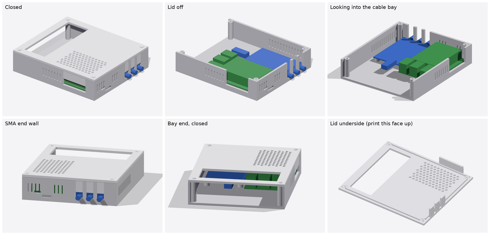
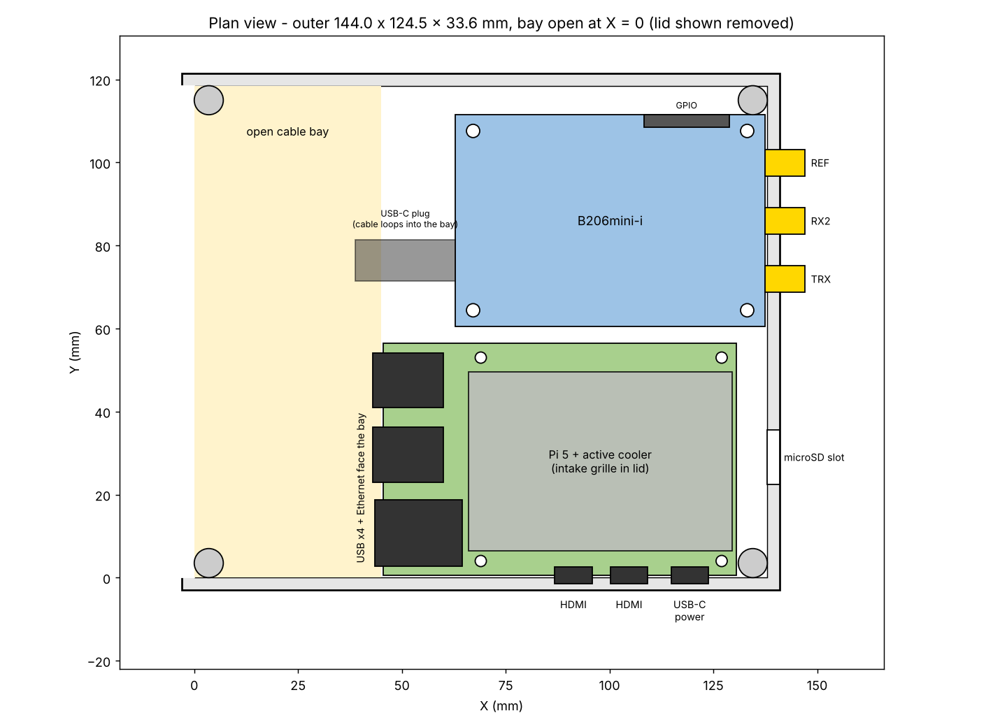
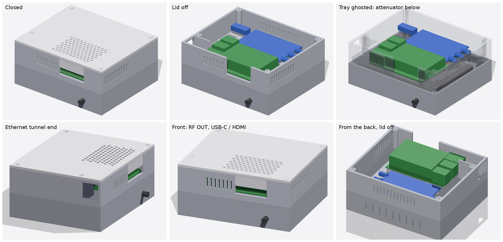
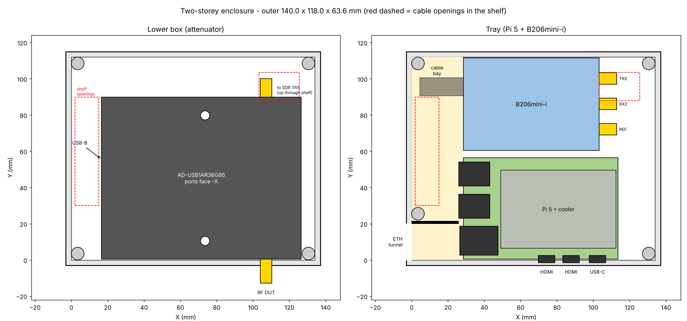

# Pi 5 + USRP B206mini-i enclosure

A compact, two-piece 3D-printable case for a Raspberry Pi 5 (with the official
Active Cooler) and an Ettus USRP B206mini-i board, generated with
`geomeTried3d`.

```bash
pip install "geometried[3d]" matplotlib
python examples/sdr_enclosure/sdr_enclosure.py            # writes to examples/sdr_enclosure/output
```

| File | What it is |
|---|---|
| `output/box.stl` | main box, print as-is (open side up) |
| `output/lid_print_orientation.stl` | lid, already flipped so it prints flat with the tabs pointing up |
| `output/lid.stl` | the same lid in its assembled position (for CAD / checking) |
| `output/assembly.glb` | box + lid + coloured placeholders for both boards |
| `output/plan.png` | dimensioned plan view |

Outer size with the default parameters: **144 x 124.5 x 33.6 mm**.



## Layout



* **Pi 5** lies along the box against the front wall. Its USB-C power
  connector and both micro-HDMI ports pass through that wall, so the PSU plugs
  straight into the case. The four USB-A ports and Ethernet face the open
  **cable bay** at the left end, where they are reachable from outside.
* **B206mini-i** lies beside the Pi. Its three SMA connectors (TRX, RX2, REF)
  pass through the right end wall; coax screws straight onto the case. Its
  USB-C port faces the bay, and a short USB-C to USB-A cable loops round inside
  the bay into one of the Pi's USB 3 ports. The reset button is on the same
  edge and is reachable through the bay.
* The right end wall also has a **microSD slot** (the card can be pushed in and
  pulled out without opening the box) and a poke-slot for the Pi's power
  button.
* The lid has an intake grille over the Active Cooler's fan; exhaust slots are
  cut in the front wall, the end wall beside the Pi, and the back wall along
  the SDR. The lid is cut away above the bay so plugs and cables are easy to
  reach; set `bay_top_open=False` for a fully closed top.

## Assembly

1. Screw the Pi onto its four standoffs (M2.5 thread-forming screws, or drill
   the standoff holes to 3.4 mm for heat-set inserts). It drops in from above;
   the USB-C/HDMI block enters the front-wall window.
2. Screw the SDR onto its four standoffs with M3 thread-forming screws; the
   SMAs drop into the U-slots in the end wall.
3. Connect the USB cable inside the bay.
4. Fit the lid: its lip locates inside the walls, the three small tabs close
   the SMA slots and the long tab closes the top of the HDMI/USB-C window.
   Four M3 countersunk screws go into the corner posts.

## Variant with the attenuator: `sdr_enclosure_attenuator.py`

```bash
python examples/sdr_enclosure/sdr_enclosure_attenuator.py   # writes to output_attenuator/
```

Adds an Adaura AD-USB1AR36G95 attenuator in a second storey underneath the
boards. Three printed parts (`lower_box`, `tray`, `lid`). The `plugs`
parameter sizes the cable spaces for the plugs you own:

| `plugs` | outer size | needs |
|---|---|---|
| `"straight"` (default) | **168.5 x 138 x 63.6 mm** | ordinary straight USB and SMA cables |
| `"right_angle"` | 140 x 118 x 63.6 mm | right-angle USB-B cable and a right-angle SMA jumper |

The orange blocks in the preview are straight plug bodies (USB-B, two SMA,
two USB-A) placed to prove the run-out room.





* RF path is SDR TRX -> attenuator -> **RF OUT** SMA on the front wall of the
  lower box. The attenuator's other SMA points sideways inside the box into a
  strip along the back wall; a short SMA jumper (about 15 cm with straight
  plugs) goes up through an opening in the shelf to the SDR's TRX connector,
  which points into the channel at the +X end of the tray. RX2 and REF stay
  inside.
* Only three things reach the outside: the RF OUT SMA, the Pi's USB-C power
  and HDMI (front wall of the tray), and the Pi's Ethernet jack through a
  tunnel in the -X end wall. A 1.6 mm partition walls the tunnel off from the
  cable bay, so the four USB-A ports beside it stay internal.
* The attenuator's USB-B port faces the -X end of the lower box across a
  45 mm channel (16.5 mm in the right-angle preset). The cable goes up through
  the second shelf opening into the bay and into a Pi USB port; the SDR's
  USB-C cable is in the same bay.
* Assembly: screw the attenuator down with two M4 countersunk screws from
  below (the attenuator's Ø5 holes are through-holes), sliding it towards the
  front wall so the RF OUT barrel enters its hole. Screw the tray to the lower
  box's corner posts (M3), mount the boards, connect the cables, fit the lid.
* The attenuator's Ethernet port and power LED are inside the box and unused.

## Printing

`output_attenuator/enclosure_all_parts.3mf` holds the three parts of the
attenuator box as separate objects, already in print orientation (lower box
and tray on their floors, lid face down). Open it in Bambu Studio and press
Arrange: on a 256 x 256 bed (X1C, P1S, A1) each 168.5 x 138 mm part gets its
own plate; on an H2D (350 x 320) all three fit one plate.

Suggested settings: 0.2 mm layers, 3 walls, 5 top/bottom layers, 15 % infill,
PETG or ASA if the box will sit somewhere warm (PLA is fine on a desk). No
supports are needed: every opening is either a vertical slot open at the top
or a short bridge, and the countersinks print as 45-degree cones. Use a brim
if your first layer tends to lift on long edges.

## Dimensions this is built on

* Raspberry Pi 5 mechanical drawing (board, holes, port positions) and the
  Active Cooler drawing (63.5 x 42.5 mm, ~14 mm tall).
* USRP B200mini board-only dimensional drawing (holes Ø3.175 mm on a
  66.0 x 43.2 mm pattern, SMAs at 11.4 / 25.4 / 39.4 mm from the TRX edge,
  9.6 mm protrusion). The B206mini-i spec sheet gives the same footprint and
  layout (84.3 x 51.0 x 8.7 mm board-only, USB Type-C), and measuring its
  board figure confirms the hole pattern within 0.5 mm, but NI has not
  published a B206mini-i drawing yet, so check the holes against your board
  before printing.

All of these numbers, plus wall thickness, clearances, fastener sizes and the
bay length, live in the `PARAMS` dictionary at the top of the script.
